# RepairHub

校園設施報修與維修追蹤平台：從報修到結案，全程看得見。

任何人都能用手機掃碼或網頁通報設施損壞（免登入或登入皆可），維修技師接單、回報進度並上傳完工照片，管理員掌握全域派工、設備履歷、公告與統計分析。

## 角色

- **Reporter（報修者）**：校園內的學生、教職員工與訪客。現場掃碼或開網頁即可通報，並追蹤修復進度、提供滿意度評分。
- **Technician（維修技師）**：內部維修團隊成員。瀏覽所屬分類的待修工單、自主接單（Claim）、記錄維修進度並附照片完工。
- **Admin（管理員）**：總務與設施管理主管。負責工單指派（Assignment）、退回待處理（Return to Pending）、設備與空間生命週期、批次匯入地點、設備與使用者、統計報表與系統公告。

## 核心能力

- **零阻力報修**：公開報修表與 QR Code 綁定地點／空間／設備，免登入也能在數十秒內完成通報；匿名寫入由 Cloudflare Turnstile 保護。
- **地點與設備兩級管理**：地點（Building）與空間（Space）組成場域樹，設備（Equipment）可各自綁定 QR Code 並累積維修履歷。
- **批次匯入**：管理員可用 XLSX／CSV 批次建立地點、設備與使用者；已存在記錄會略過，並逐列回報建立、略過與失敗結果。匯入或重設的使用者帳號以完整 Email 作為預設密碼，必須先改密碼才能使用管理後台。
- 新增與重設的密碼最少 8 碼。
- **工單生命週期閉環**：接單、完工（須附照片與維修說明）、報修者確認或七日自動關單、未完成重開單（Reopen）。
- **Email 通知**：新工單與狀態變更由資料庫觸發器派送，收件人為報修者與已訂閱分類且未關閉偏好的技師；失敗只記錄錯誤與重試時間，不中斷工單寫入。
- **管理後台**：待修佇列、工單詳情與時間軸、維修紀錄、QR Code 批次產生與匯出、Excel／PDF 報表、滿意度分析、公告與系統設定。
- **個人設定**：側欄使用者選單可更新基本資料、修改密碼、調整 Email 通知偏好與刪除帳號。
- **響應式與主題**：手機現場操作、桌面管理中心兩種密度；淺色／深色模式與主題預設檔，全站使用語意化 CSS 變數。

## 技術棧

| 層級 | 使用技術 |
| --- | --- |
| 前端框架 | Next.js 16（App Router）、React 19、TypeScript strict |
| 樣式與元件 | Tailwind CSS v4、shadcn/ui（`radix-nova`）、lucide-react |
| 後端服務 | Supabase：Auth、Postgres（含 RLS）、Storage、`pg_net`、`pg_cron`、Vault |
| 背景工作 | Deno Edge Function `send-ticket-email`，透過 Resend 寄信 |
| 資料視覺 | TanStack Table、Recharts、ExcelJS、jsPDF、qrcode |
| 工具鏈 | Biome、husky + lint-staged、tsx |

本地元件放在 `src/components/ui/` 與 `src/components/calendar/`，任何客製化都在使用處進行，不修改這些目錄。

## 快速開始

```bash
npm install
npm run dev
```

開發伺服器預設在 <http://localhost:3000>。

常用指令：

| 指令 | 用途 |
| --- | --- |
| `npm run dev` | 啟動開發伺服器 |
| `npm run build` | 產出正式版本（使用 `--webpack`） |
| `npm run lint` / `npm run check` | Biome 檢查 |
| `npm run check:fix` / `npm run format` | 自動修正與排版 |
| `npm run generate:presets` | 重新產生主題預設檔 |

資料庫 migration 依時間排序放在 `supabase/migrations/`，套用方式與 Email 通知的正式環境佈建流程見 [docs/notifications.md](docs/notifications.md)。

## 環境變數

應用程式（`.env.local`，參考 [.env.local.example](.env.local.example)）：

| 變數 | 用途 |
| --- | --- |
| `NEXT_PUBLIC_SUPABASE_URL` | Supabase 專案 URL（瀏覽器可見） |
| `NEXT_PUBLIC_SUPABASE_PUBLISHABLE_KEY` | 瀏覽器用的 publishable key |
| `SUPABASE_SECRET_KEY` | 僅伺服端使用的 secret key，絕不可加 `NEXT_PUBLIC_` 前綴 |
| `NEXT_PUBLIC_TURNSTILE_SITE_KEY` | Cloudflare Turnstile 網站金鑰 |
| `TURNSTILE_SECRET_KEY` | Cloudflare Turnstile 驗證金鑰，Supabase Auth CAPTCHA 與應用伺服端須相同 |

Edge Function（`supabase/functions/.env`，已 gitignore，參考 [.env.example](supabase/functions/.env.example)）：

| 變數 | 用途 |
| --- | --- |
| `REPAIRHUB_EDGE_FUNCTION_SECRET` | DB 呼叫 Edge Function 的內部密鑰，須與 Vault 值完全相同 |
| `RESEND_API_KEY` / `RESEND_FROM` / `RESEND_REPLY_TO` | Resend 寄信設定 |
| `APP_BASE_URL` | 郵件中的連結網域 |

Supabase Vault 另需兩個純文字 secret：`repairhub_project_url` 與 `repairhub_edge_function_secret`。兩者若以 bytea 寫入，`vault.decrypted_secrets` 會回報 `\x...` 轉義字串，導致 `net.http_post` 報 `invalid URL`、Edge Function 回 401，寫入時的 trigger 也會一併中斷；檢查與部署步驟見 [docs/notifications.md](docs/notifications.md)。

## 畫面結構

| 路徑 | 內容 | 存取 |
| --- | --- | --- |
| `/` | 首頁：服務說明與「我要報修」入口 | 公開 |
| `/report` | 報修表單（可選地點、空間、設備，支援上傳照片） | 公開 |
| `/track` | 報修進度查詢（免登入追蹤） | 公開 |
| `/login`、`/forgot-password`、`/reset-password` | 帳號流程 | 公開 |
| `/check-email` | 註冊後等待信箱驗證 | 公開 |
| `/dashboard` | 總覽：待修數量、公告、快速入口 | 登入 |
| `/dashboard/tickets`、`/dashboard/tickets/[id]` | 待修佇列與工單詳情（接單、完工、退回、取消） | 登入 |
| `/dashboard/my-tickets` | 我通報的工單 | 登入 |
| `/dashboard/equipment` | 設備與履歷管理（支援 XLSX／CSV 匯入） | 管理員 |
| `/dashboard/repair-records` | 維修紀錄查詢 | 登入 |
| `/dashboard/qr-codes` | QR Code 批次產生、列印與匯出 | 管理員 |
| `/dashboard/reports` | 統計報表（Excel／PDF 匯出、滿意度） | 管理員 |
| `/dashboard/announcements` | 系統公告管理 | 管理員 |
| `/dashboard/settings` | 地點、空間、分類、人員與權限設定（支援 XLSX／CSV 匯入） | 管理員 |

## 系統架構



Mermaid 原始檔：[docs/diagrams/architecture.mmd](docs/diagrams/architecture.mmd)；圖表 HTML 來源：`docs/diagrams/architecture.html`。

前台與儀表板共用 Next.js App Router：公開頁面以匿名或登入身分讀寫 Supabase，`@supabase/ssr` 管理 session；儀表板依角色（technician／admin）限制可見範圍。寫入路徑集中在 Server Action 與 `src/server/tickets/lifecycle.ts`，工單照片走 Storage 的 `ticket-photos` bucket。資料庫觸發器負責通知派送，因此寄信失敗不會回滾工單。

## 資料模型



工單（Ticket）是聚合根：地點（Building）與空間（Space）組成兩級場域，設備（Equipment）掛在空間下並可被工單引用；技師透過 `technician_categories` 訂閱分類，這份訂閱同時決定新工單通知的收件人。工單照片（ticket_photos）以 phase 區分報修與完工。



工單的附屬表：`ticket_notes` 同時承載維修記事與 `status_change` 流轉紀錄（對照上面的狀態機）、`notification_log` 是每封通知信的派送帳務（含重試次數與下次嘗試時間，對照通知派送流程）、`announcements` 由人員發布。圖分兩張是因為 Diagram Design 的 ER 上限為 8 個實體。

Mermaid 原始檔：[docs/diagrams/data-model.mmd](docs/diagrams/data-model.mmd)（列出全部 11 張表，含各表未畫進圖的欄位與 unique 條件）。實體定義以 `supabase/migrations/` 為準；各表共通的 `created_at` / `updated_at` 等稽核欄位未畫出。

## 工單狀態



Mermaid 原始檔：[docs/diagrams/ticket-status.mmd](docs/diagrams/ticket-status.mmd)。

允許的流轉由 `src/server/tickets/lifecycle.ts` 統一檢查（錯誤碼 `INVALID_PREVIOUS_STATUS`），每筆流轉都會留下 `status_change` 記事；完工逾七日未回覆由 `pg_cron` 每日 03:00 UTC 自動結單。

## 通知派送



Mermaid 原始檔：[docs/diagrams/notification-pipeline.mmd](docs/diagrams/notification-pipeline.mmd)。

派送鏈為 `enqueue_notification_delivery` → `notification_log` → `invoke_notification_delivery` → `pg_net` → Edge Function `claim_notification_delivery` → Resend。事件鍵（`ticket:<id>:<event>:<ts>`）與 `ON CONFLICT DO NOTHING` 保證同一事件不重複寄送；每筆 delivery 最多五次 claim，其間隔約五分鐘、十五分鐘、一小時與六小時，由 `pg_cron` 每五分鐘接手 pending、已到期 failed 與逾時卡住的 sending 項目。詳情與 Vault 檢查見 [docs/notifications.md](docs/notifications.md)。

## 開發規範

- 先讀 [AGENTS.md](AGENTS.md)：本版 Next.js 有破壞性變更，寫程式前請參考 `node_modules/next/dist/docs/` 的對應指南。
- UI 文案一律繁體中文，領域術語以 [GLOSSARY.md](GLOSSARY.md) 為準（Ticket、地點、空間、設備、接單、結案…）。
- 畫面元件放在所屬路由的 `_components/`，`page.tsx` 預設維持 Server Component；跨功能共用的元件才移到 `src/components/`。
- 樣式使用語意化 theme token，不寫死色碼；需要新顏色時從 Tailwind 預設調色盤命名取用。
- 提交訊息使用英文 Conventional Commits（例如 `fix(auth): allow any email domain`），PR 內容以繁體中文撰寫。
- 提交前由 husky 執行 lint-staged（`biome check --write`）。

## 文件

- [docs/notifications.md](docs/notifications.md)：Email 通知基礎、必要 secrets 與正式環境佈建
- [PRODUCT.md](PRODUCT.md)：產品定位、使用者與能力邊界
- [GLOSSARY.md](GLOSSARY.md)：領域詞彙與禁用詞
- [DESIGN.md](DESIGN.md)：設計系統 token
- [AGENTS.md](AGENTS.md)：給 agent 的專案規範

### 決策記錄

- [0001-supabase-over-firebase.md](docs/adr/0001-supabase-over-firebase.md)：後端選用 Supabase
- [0002-mixed-auth-anonymous-and-login.md](docs/adr/0002-mixed-auth-anonymous-and-login.md)：免登入通報搭配登入追蹤
- [0003-notifications-via-database-webhook.md](docs/adr/0003-notifications-via-database-webhook.md)：通知走資料庫觸發器
- [0004-optional-ticket-space.md](docs/adr/0004-optional-ticket-space.md)：空間欄位可為空
- [0005-notification-dispatch-failures-do-not-block-tickets.md](docs/adr/0005-notification-dispatch-failures-do-not-block-tickets.md)：派送失敗不阻斷工單
- [0006-open-registration-and-login-to-any-email-domain.md](docs/adr/0006-open-registration-and-login-to-any-email-domain.md)：開放任意網域註冊登入
- [0007-bulk-import-forces-password-reset.md](docs/adr/0007-bulk-import-forces-password-reset.md)：批次匯入使用者的預設密碼需強制重設
- [0008-cloudflare-turnstile-for-anonymous-writes.md](docs/adr/0008-cloudflare-turnstile-for-anonymous-writes.md)：匿名寫入用 Cloudflare Turnstile 保護
- [0009-notification-preferences-on-profiles.md](docs/adr/0009-notification-preferences-on-profiles.md)：通知偏好存在個人檔案
